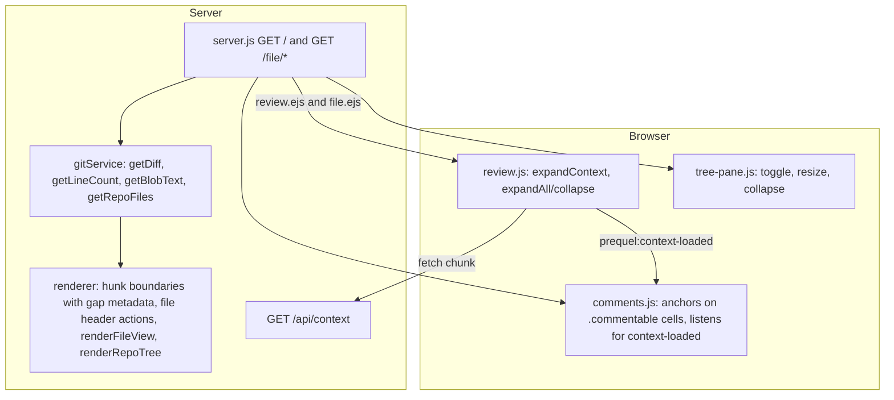

# Context Expansion and File View - Plan

## Goal Capsule

- **Objective:** Let a reviewer see as much of a changed file as they want without leaving prequel: GitHub-style context expansion inside each diff, and a per-file "View file" page with a repository tree.
- **Product authority:** Repo owner (sole developer and primary user). GitHub's Pull Request "Files changed" tab and file (blob) view are the visual reference. The Product Contract below is authoritative for behavior; the Planning Contract is authoritative for how it is built.
- **Execution profile:** Six implementation units in dependency order, U1 first. Units U2 to U4 (expansion) are independently shippable before U5 and U6 (file page).
- **Stop conditions:** Stop and surface if a requirement cannot be met without changing the comment data contract consumed by the export and the `/prequel` skill, or if the file page cannot reuse the comment anchoring contract described in KTD-4.
- **Tail ownership:** The executor runs the Verification Contract, removes abandoned code, and reports the manual browser checklist results.
- **Open blockers:** None.

---

## Product Contract

### Summary

Add up/down/all context expanders to every hunk boundary, a per-file "Expand all" control, and a "View file" action that opens the whole file on its own page with a repo tree on the left. Review comments work on expanded lines and on the file page.

### Problem Frame

Reviewing a diff often needs the surrounding code. Today an expander appears only above a hunk that has a hidden gap, so a file whose first hunk starts at line 1 offers no way to see the rest of the file, and nothing after the last hunk can be revealed. There is no way to open a file in full or browse the rest of the repository. The reviewer either switches to an editor or pushes to GitHub, which defeats the purpose of a local review harness.

### Key Decisions

- **Match GitHub's expansion model.** Expanders live in the gutter at hunk boundaries and reveal a fixed chunk per click, with a single "expand all" affordance when the gap is small. Reviewers already know this model; no new learning.
- **Ship expansion in two halves.** Boundary arrows first (they complete the existing expander), then the per-file "Expand all" control. Each half is useful alone.
- **"View file" is a separate page, not an in-place mode.** Each file gets its own URL, so it can be linked, refreshed, and opened in a second tab. The cost is leaving the review, so the page must offer a clear way back.
- **The file page allows review comments.** Unlike GitHub's blob view, prequel is a review harness, so a comment on any line of a changed file is first-class: same store, same live stream, same export, same agent skill.
- **Commenting is limited to changed files.** The tree shows every file in the repository, but only files in the current diff accept comments. Comments on other files would have no place to appear on the review page.
- **The file page shows the working-tree content.** It matches the "new" side of the diff. A deleted file shows the base version, read-only.

### Requirements

**Context expansion in the review**

- R1. Every hunk boundary with hidden lines shows an expander in the gutter: above the first hunk when it does not start at line 1, between hunks, and after the last hunk when the file continues.
- R2. A boundary with a gap larger than one chunk offers separate "expand up" and "expand down" controls; a gap of one chunk or less offers a single "expand all" control.
- R3. One click reveals one chunk of unchanged lines (20 lines, matching GitHub) adjacent to the control, and the control disappears once the gap is fully revealed.
- R4. Revealed lines are syntax-highlighted and numbered like the rest of the diff, in both unified and split views.
- R5. Revealed lines accept review comments exactly like diff lines, and those comments export and stream like any other.
- R6. Each file header has an "Expand all" control that reveals every hidden line in that file in one action and turns into "Collapse" to undo it.

**View file page**

- R7. Each file header has a "View file" action that opens that file on its own page, at its own URL.
- R8. The file page shows the full file with line numbers and syntax highlighting, using the same light/dark theming as the review.
- R9. Lines that are added or changed in the current diff are visibly marked in the file page gutter.
- R10. The file page has a left pane with a tree of the whole repository; files in the current diff are marked, and clicking a file opens it in the same page.
- R11. The tree can be collapsed and resized, matching the changed-files pane on the review page.
- R12. The file page shows a breadcrumb (repo, directories, file name) and a link back to the review that returns the reviewer to the same file in the diff.
- R13. For files in the current diff, the file page accepts review comments on any line; existing threads for that file appear inline.
- R14. Files not in the current diff are read-only on the file page.
- R15. A deleted file opens as its base version and is read-only.

### Key Flows

- F1. Peek at surrounding code
  - **Trigger:** Reviewer wants a few more lines above or below a hunk.
  - **Steps:** Click the gutter arrow; 20 lines appear; click again for more; the arrow disappears when the gap is closed.
  - **Outcome:** Reviewer stays in the review. Revealed lines can be commented.
  - **Covers:** R1, R2, R3, R4, R5.

- F2. Read the whole changed file
  - **Trigger:** Reviewer wants the entire file in context.
  - **Steps:** Click "Expand all" in the file header; every hidden line appears in place; "Collapse" returns to the compact diff.
  - **Outcome:** Full file inline, change tint preserved.
  - **Covers:** R6, R4, R5.

- F3. Open the file page and come back
  - **Trigger:** Reviewer clicks "View file" on a file header.
  - **Steps:** File page opens at its URL; reviewer reads, browses the repo tree, optionally leaves a comment on a changed file; clicks the back link.
  - **Outcome:** Reviewer lands back on the review, scrolled to the same file. Any new comment is already visible there.
  - **Covers:** R7, R8, R9, R10, R11, R12, R13.

### Acceptance Examples

- AE1. **Covers R1.** Given a file whose only hunk is `@@ -1,11 +1,11 @@` and the file has 40 lines, when the review renders, then no expander appears above the hunk and an "expand down" expander appears after line 11.
- AE2. **Covers R2, R3.** Given a 15-line gap between two hunks, when the reviewer clicks the single "expand all" control, then all 15 lines appear and the control is removed.
- AE3. **Covers R2, R3.** Given a 60-line gap between two hunks, when the reviewer clicks "expand down" on the upper boundary, then 20 lines appear below the first hunk and both controls remain.
- AE4. **Covers R5.** Given a revealed unchanged line, when the reviewer adds a comment on it, then the comment appears in the thread, in the export, and in the live event stream like a comment on a diff line.
- AE5. **Covers R13, R14.** Given the file page shows `src/index.js` (not in the diff), when the reviewer hovers a line, then no comment affordance appears; given it shows `src/cart.js` (in the diff), then the affordance appears on every line.
- AE6. **Covers R12.** Given the reviewer opened the file page from `src/format.js`, when they click the back link, then the review page is scrolled to `src/format.js`.
- AE7. **Covers R15.** Given `src/old.js` was deleted in the diff, when the reviewer opens it from the tree, then the base version is shown and commenting is disabled.

### Scope Boundaries

- No blame, symbols pane, raw view, download, or in-browser editing on the file page.
- No search or filter inside the repo tree.
- Comments on files outside the current diff. Deferred until the review page has somewhere to show them.
- No changes to the export format or the agent skill beyond what falls out of comments on unchanged lines.

### Deferred to Follow-Up Work

- Gap-between-hunks behavior today loads the whole gap in one click. This plan replaces it with chunked expansion (R2, R3); no separate follow-up is needed, but a "load whole gap" shortcut could return later as a modifier-click.
- A "Changed / Repo" tab pair in the file page tree, sketched during the brainstorm but not required by R10.

### Sources

- Existing expander: `src/render/renderer.js` (`hunkHeaderRow`) renders one expander only when a gap exists above the hunk; `public/js/review.js` (`expandContext`) fetches 20-line chunks from `/api/context`.
- Existing changed-files tree: `src/render/renderer.js` (`renderFileTree`) and `views/review.ejs` (`.file-tree-pane`, `.tree-resizer`).
- Blob access: `src/git/gitService.js` (`getBlobLines`).
- GitHub "Expanding context in diffs" (github.blog, 2013-12-02): unfold button in the gutter, click repeatedly to reveal the whole file.
- GitHub changelog 2025-09-25: the new "Files changed" page allows comments on unchanged lines after expansion, limited to files already modified.

---

## Planning Contract

**Product Contract preservation:** changed: F3 now lists R11 in its Covers line for traceability; no behavior change. Added a "Deferred to Follow-Up Work" subsection under Scope Boundaries for plan-local sequencing notes.

### Key Technical Decisions

- **KTD-1. The server supplies each file's new-side line count at render time.** The renderer cannot place a trailing expander (R1) without knowing where the file ends. After the diff is parsed, the server reads each non-binary file once (working tree or `HEAD`, mirroring the existing `rev` choice) and attaches the count to the file object. The cost is one file read per changed file, acceptable for a local tool. Alternative rejected: an open-ended "expand down until end of file" client loop, which would show a trailing control on files that do not continue.
- **KTD-2. The client owns up/down/all logic from gap metadata on the boundary row.** Each boundary row carries the gap's new-side start and end plus the old/new offset. The client renders one "all" button when the gap is 20 lines or fewer, otherwise "up" and "down" buttons. The top boundary shows only "up"; the trailing boundary shows only "down". After each fetch the client shrinks the gap on the row and re-derives the buttons. This keeps `/api/context` unchanged and the renderer free of client state.
- **KTD-3. Expanded rows use the same DOM contract as server-rendered context rows.** The comment layer anchors on a `.file[data-path]` ancestor, a gutter cell marked `commentable` with `data-side` and `data-comment-line`, and a following code cell. Client-built rows emit exactly that markup, so R5 needs no changes to the comment store, the export, or the `/prequel` skill. After rows are inserted the client dispatches a document-level event so the comment layer can inject threads whose anchor was missing before.
- **KTD-4. The file page reuses the review's comment layer by rendering the file as a one-hunk unified table inside a `.file[data-path]` wrapper.** The gutter marks every line `commentable` on the `new` side when the file is in the diff, and nothing when it is not (R13, R14). The same `comments.js` script loads on the file page; its export and clear controls are null-guarded since the page does not have them.
- **KTD-5. Tree pane behavior moves to a shared script.** Toggle, resize, and folder collapse are extracted from `public/js/review.js` into `public/js/tree-pane.js`, loaded by both pages, keeping the same localStorage keys so the pane state carries across pages (R11).
- **KTD-6. The repo tree is built from the same revision the file route reads.** In `working` and `all` modes: `git ls-files --cached --others --exclude-standard`. In `branch` mode: `git ls-tree -r --name-only HEAD`, so the tree never lists a staged or untracked file the page cannot show. Deleted files are appended from the diff so R15 has a tree entry. The existing `buildTree` and `compressTree` are reused with synthetic file objects; unchanged files carry no counts.
- **KTD-7. Revisions for the file page follow the review's `rev` rule.** Working-tree content for `working` and `all` modes, `HEAD` for `branch` mode. A deleted file is read from the base revision: `HEAD` in `working` mode, the merge-base in `branch` and `all` modes. `getDiff` returns the merge-base SHA so the server can pick it without recomputing.
- **KTD-8. Large content renders fully; highlighting is skipped past 5,000 lines.** Applies to the file page and to `/api/context` ranges (so "Expand all" on a huge gap cannot stall the tokenizer). Above the threshold the server returns escaped plain text and the page shows a one-line notice above the table. Highlighting is the expensive step and its cache is keyed on full text. Alternative rejected: lazy rendering, which complicates comment anchoring for no gain at typical repo sizes.
- **KTD-9. Tests use Node's built-in test runner with a temporary git fixture repo.** No new dependencies. Server routes are tested by listening on an ephemeral port and using global `fetch`. Browser JavaScript is verified manually via the checklist in the Verification Contract; there is no DOM test environment and adding one is out of scope.

### High-Level Technical Design

Expansion data flow: the renderer writes gap metadata on each boundary row; `review.js` fetches chunks from `/api/context`, inserts rows with the commentable contract, updates the remaining gap, and notifies `comments.js`. File page composition: the route resolves the revision, reads the file, computes the changed-line set from the current diff, renders the table and repo tree, and the page loads `tree-pane.js` and `comments.js`.

### Assumptions

- The demo repo in the scratchpad and any real repo are small enough that one extra read per changed file at render time is unnoticeable.
- The `/prequel` skill locates comments by `lineSnapshot` first, so comments on unchanged lines need no skill changes.

---

## Implementation Units

### U1. Test harness and fixture repo

- **Goal:** Give the repo a test runner and a reusable temporary git repository so later units ship with tests.
- **Requirements:** Supports all units; no product requirement directly.
- **Dependencies:** None.
- **Files:** `package.json` (add `test` script running `node --test`), `test/helpers/fixture-repo.js` (create), `test/git-service.test.js` (create).
- **Approach:** The helper creates a temp directory, runs `git init`, commits a few files on `main`, creates a feature branch with a committed change, a staged change, an unstaged change, an untracked file, and a deleted file. It returns the path and a cleanup function. The first test exercises `getDiff` in all three modes against the fixture to prove the harness works.
- **Patterns to follow:** `src/git/gitService.js` uses `execFile` with `-C repoRoot`; the helper does the same with fixed author config flags.
- **Test scenarios:**
  - Fixture creates a repo where `getDiff` in `working` mode lists the staged, unstaged, and untracked files.
  - `getDiff` in `branch` mode lists only the committed feature change.
  - `getDiff` in `all` mode lists the union and returns a merge-base SHA once U5 lands.
- **Verification:** `pnpm test` runs and passes; the fixture cleans up its temp directory.

### U2. Boundary metadata and line counts in the renderer

- **Goal:** Render a boundary row at every hidden gap, including the trailing gap, with enough metadata for the client to offer up/down/all controls.
- **Requirements:** R1, R2 (server side).
- **Dependencies:** U1.
- **Files:** `src/git/gitService.js` (add `getLineCount`), `src/server.js` (attach `newLineCount` per file after highlighting), `src/render/renderer.js` (`hunkHeaderRow`, `renderUnifiedTable`, `renderSplitTable`, new trailing boundary row), `public/css/diff.css` (boundary row and button variants), `test/renderer.test.js` (create).
- **Approach:** `getLineCount` reads the file for the given `rev` and returns its line count, or `0` when unreadable. The server runs it for every non-binary file in parallel. `hunkHeaderRow` emits `data-gap-start-new`, `data-gap-end-new`, and `data-offset` when the gap above is positive, keeping the header text. After the last hunk, when `newLineCount` exceeds the hunk's new end, the table gets a trailing boundary row with the same attributes and no header text. The gutter contains a placeholder that the client fills with buttons, so the renderer stays free of chunk logic. Removed files never get a trailing row.
- **Patterns to follow:** Existing `hunkHeaderRow` data attributes; `hunkNewEnd`/`hunkOldEnd` for the offset.
- **Test scenarios:**
  - Covers AE1. A file whose only hunk starts at line 1 with 40 total lines renders no expander above and one trailing boundary with gap 12 to 40.
  - Two hunks separated by 15 unchanged lines render one boundary row between them with the correct start, end, and offset.
  - A hunk starting at line 30 renders a top boundary with gap 1 to 29.
  - A file whose last hunk ends at the last line renders no trailing boundary.
  - A removed file renders no trailing boundary.
  - Split and unified tables produce boundary rows with the right column spans.
- **Verification:** Tests pass; loading the demo repo shows a trailing expander under `src/cart.js`.

### U3. Chunked up/down/all expansion with commentable rows

- **Goal:** Replace the single expander with GitHub-style controls that reveal 20 lines per click and produce commentable rows.
- **Requirements:** R2, R3, R4, R5.
- **Dependencies:** U2.
- **Files:** `public/js/review.js` (`contextRow`, `expandContext`, button rendering), `public/js/comments.js` (listen for the context-loaded event and inject pending threads; null-guard export and clear buttons), `public/css/diff.css` (up/down/all icons and hover states).
- **Approach:** On load, `review.js` decorates each boundary row from its gap attributes: one "all" button when the gap is at most 20 lines, otherwise "up" and "down"; top boundaries get only "up", trailing boundaries only "down". A click fetches the chunk adjacent to the clicked direction from `/api/context`, inserts rows on the right side of the boundary, shrinks the gap attributes, and re-derives the buttons or removes the row when the gap is closed. `contextRow` emits the gutter contract from KTD-3, including the add-comment button, on the new side in both views. After inserting rows, dispatch `prequel:context-loaded` with the file path; `comments.js` re-runs thread injection for comments in that file whose anchor was missing. On page load, after comments are fetched, `comments.js` asks `review.js` (via a `prequel:reveal-line` event carrying file path and line) to expand the gap containing each comment that has no anchor, so a comment left on the file page or on a previously revealed line is visible without a manual click.
- **Execution note:** Verify the comment contract in the browser first: expand a gap, add a comment, confirm it appears in the export and survives a reload.
- **Patterns to follow:** Existing `expandContext` fetch and insertion; `numCell` markup in `src/render/renderer.js` for the exact classes and attributes.
- **Test scenarios:** Browser JavaScript has no automated runner. Manual scenarios:
  - Covers AE2. A 15-line gap shows one control; one click fills it and removes the row.
  - Covers AE3. A 60-line gap shows two controls; "expand down" adds 20 lines below the upper hunk and both controls remain.
  - Top boundary at line 30 shows only "up"; clicking twice reaches line 1 and removes the row.
  - Trailing boundary shows only "down"; clicking until the end removes the row.
  - Covers AE4. A comment on a revealed line appears in the thread, in the export file, and in a second tab via the live stream.
  - A comment stored on an unchanged line is visible after reload without clicking any expander; its gap auto-expands.
  - Split view renders revealed rows with matching old and new numbers.
- **Verification:** All manual scenarios pass on the demo repo in both views and both color modes.

### U4. Per-file Expand all and Collapse

- **Goal:** Add a file-header control that reveals every hidden line of a file and can undo it.
- **Requirements:** R6.
- **Dependencies:** U3.
- **Files:** `src/render/renderer.js` (`renderFile` header button), `public/js/review.js` (expand-all and collapse handlers), `src/server.js` (`/api/context` applies the KTD-8 threshold), `public/css/diff.css` (button styling), `test/context-route.test.js` (create).
- **Approach:** "Expand all" iterates the file's boundary rows and requests each full gap in one call per boundary, inserting rows through the same code path as U3. The boundary rows are kept in the DOM, hidden, with their original gap attributes preserved. "Collapse" removes rows marked as loaded context, restores and re-decorates the boundary rows, and dispatches the same context-loaded event so `comments.js` removes threads whose anchor is gone. The button label toggles between "Expand all" and "Collapse"; state is not persisted across reloads. `/api/context` skips highlighting when the requested range exceeds 5,000 lines and returns `html: null` plus a `plain: true` flag; the client shows the size notice.
- **Patterns to follow:** `collapse-btn` and `viewed-toggle` header controls in `renderFile`.
- **Test scenarios:** Manual scenarios:
  - A file with three gaps expands fully in one click and shows no boundary rows.
  - "Collapse" returns the file to the original diff with all boundary controls restored.
  - A comment added on a revealed line survives Collapse in the store and reappears on the next Expand all.
  - A file with no hidden lines shows the control disabled.
  - Automated: `/api/context` for a 6,000-line range returns `html: null` and `plain: true`; a 100-line range returns highlighted html.
- **Verification:** Manual scenarios pass; `pnpm test` passes.

### U5. File page data: repo listing, whole-file read, revisions, route

- **Goal:** Serve a file page route that resolves the right revision, reads the file, computes changed lines, and lists the repository.
- **Requirements:** R8, R9, R14, R15 (server side).
- **Dependencies:** U1.
- **Files:** `src/git/gitService.js` (add `getRepoFiles`, `getBlobText`; make `getBlobLines` use `getBlobText`; return merge-base SHA from `getDiff`), `src/server.js` (`GET /file/*` route), `src/render/renderer.js` (`renderFileView`, `renderRepoTree`), `test/git-service.test.js` (extend), `test/file-route.test.js` (create).
- **Approach:** The route takes the repo-relative path from the URL and the same `diff`, `base`, `view`, and `mode` query parameters as the review. It computes the current diff, finds the file, and picks the revision per KTD-7. A path outside the repo returns 404 (the repo-root guard moves into `getBlobText` and applies to every read). A path not present at that revision returns 404 via an explicit existence check (`fs.stat` for the working tree, `git cat-file -e <rev>:<path>` for a revision); an empty file is 200. Binary content (the diff's binary flag for changed files, a NUL-byte sniff otherwise) renders the existing `.binary-notice` instead of a table. The changed-line set is the new-side numbers of added lines in that file's hunks; deleted files have none. `renderFileView` produces a unified table with every line numbered, `commentable` cells only when the file is in the diff and not deleted, and an addition class on changed gutter cells. Files above 5,000 lines skip highlighting per KTD-8. `renderRepoTree` builds from `getRepoFiles` plus deleted paths, marks changed files with the status dot, and links each row to `/file/<path>` with the query string preserved. The route also computes `backHref` (review URL with the same params, plus `#diff-<id>` only when the file is in the diff; other files return to the top of the review) and breadcrumb segments, each passed through `escapeHtml` like every other path string in the renderer.
- **Patterns to follow:** `/api/context` parameter validation and the path-traversal guard in `getBlobLines`; `buildTree`/`compressTree` input shape.
- **Test scenarios:**
  - `getRepoFiles` on the fixture returns tracked and untracked files and excludes ignored ones.
  - `getBlobText` reads working-tree content for `WORKTREE` and committed content for `HEAD`.
  - `getDiff` in `branch` and `all` modes returns the merge-base SHA.
  - Route returns 200 and HTML containing every line of `src/cart.js` for a changed file, with commentable gutter cells.
  - Covers AE5. Route for an unchanged file returns HTML with no commentable cells.
  - Covers AE7. Route for the deleted fixture file returns the base content with no commentable cells.
  - Route for a path outside the repo (`../etc/passwd`) and for a missing file returns 404; an empty tracked file returns 200.
  - In `branch` mode the tree omits a staged-only file and includes it in `working` mode.
  - A binary changed file renders the binary notice and no commentable cells.
  - A directory named `` appears escaped in the breadcrumb HTML.
  - `backHref` for a file outside the diff carries no fragment.
  - Changed lines in the response carry the addition gutter class and unchanged lines do not.
  - A generated 6,000-line file renders without highlight tokens and with the size notice.
- **Verification:** Tests pass; `curl` of `/file/src/cart.js` on the demo repo returns the full file.

### U6. File page view, shared tree pane, and review integration

- **Goal:** Ship the visible file page with breadcrumb, repo tree, back link, comments, and the "View file" action on the review.
- **Requirements:** R7, R10, R11, R12, R13.
- **Dependencies:** U3, U5.
- **Files:** `views/file.ejs` (create), `views/partials/head.ejs` (create, shared `<head>` and html data attributes), `views/review.ejs` (use the partial), `public/js/tree-pane.js` (create, extracted from `public/js/review.js`), `public/js/review.js` (remove extracted code), `public/js/comments.js` (load on file page; null-guard page-specific controls), `src/render/renderer.js` (`renderFile` "View file" link), `public/css/diff.css` (breadcrumb, file page layout, repo tree rows without counts), `README.md` (file page URL and expand controls).
- **Approach:** `file.ejs` renders the shared head, a header with a back link and breadcrumb, the same `.review-layout` with the repo tree in the left pane, and the file table inside a `.file[data-path]` wrapper in the main pane. It sets `data-comments-enabled` and `data-branch` like the review so `comments.js` behaves identically. A deleted file shows a "Deleted in this diff, showing base version" notice above the table; the large-file notice reads "Syntax highlighting off for files over 5,000 lines". Breadcrumb segments are static text. `tree-pane.js` owns toggle, resize, and folder collapse for both pages with the existing localStorage keys. The "View file" link in each review file header points to `/file/<newPath>` with the current query string; removed files use the old path. The back link uses `backHref` from U5 so the review lands on the file's anchor.
- **Execution note:** Smoke-check both pages in light and dark mode before polishing; theming comes from the shared head partial.
- **Patterns to follow:** `views/review.ejs` layout and data attributes; `.tree-*` classes in `public/css/diff.css`.
- **Test scenarios:** Manual scenarios:
  - "View file" on `src/cart.js` opens the file page with the full file, changed lines marked, and the tree highlighting `src/cart.js`.
  - Clicking `README.md` in the tree opens it in the same page.
  - Covers AE6. The back link returns to the review scrolled to the originating file.
  - Tree collapse and width persist between the review and the file page.
  - Covers AE5. Hovering a line on `src/cart.js` shows the comment button; on `src/index.js` it does not.
  - A comment added on the file page appears on the review page after expansion and in the export.
  - Light and dark mode render correctly on the file page.
- **Verification:** Manual scenarios pass; existing review page behavior (toggles, viewed, collapse, tree) is unchanged.

---

## Verification Contract

| Gate | Command or check | Applies to | Done signal |
|---|---|---|---|
| Unit and route tests | `pnpm test` | U1, U2, U5 | All tests pass |
| Server smoke | `node bin/prequel.js <demo-repo> --no-open` then `curl localhost:4711/healthz` and `curl localhost:4711/file/src/cart.js` | U2, U5, U6 | 200 responses with expected content |
| Browser checklist | Manual scenarios listed in U3, U4, U6 on the demo repo, unified and split, light and dark | U3, U4, U6 | Every scenario passes |
| Regression | Existing review features: view and diff toggles, Viewed, collapse, tree toggle and resize, comment compose and export, live stream in a second tab | U3, U4, U6 | No behavior change |

The demo repo for manual checks is the scratchpad repo created during the brainstorm, or any repo with a branch, staged, unstaged, untracked, and deleted files (the fixture helper from U1 can generate one).

---

## Definition of Done

- All fifteen requirements are met and each acceptance example passes as described in its unit.
- `pnpm test` passes and covers U1, U2, and U5.
- The manual browser checklist passes in unified and split views and in light and dark modes.
- The comment store shape, the export format, and the `/prequel` skill are unchanged.
- No abandoned or experimental code remains in the diff.
- `README.md` mentions the file page URL and the expand controls in the URL params and layout sections.
