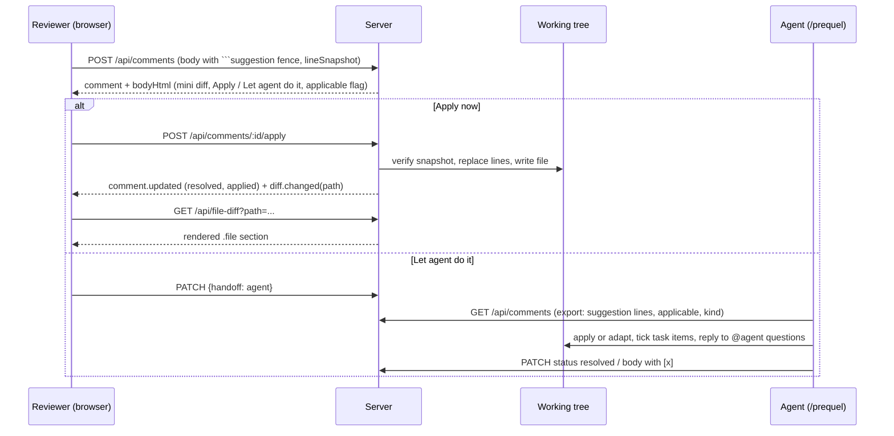

# Comment Composer and Suggestions - Plan

## Goal Capsule

- **Objective:** Give prequel's comment box the power of GitHub's PR review composer: Write/Preview, a formatting toolbar with tooltips and shortcuts, and suggestion blocks that a reviewer can apply to the working tree in one click or hand to the coding agent.
- **Product authority:** Repo owner (sole developer and primary user). GitHub's PR review comment box is the visual and behavioral reference, pruned to what makes sense for a local, single-user tool with an agent on the other side.
- **Execution profile:** Seven implementation units in dependency order. U1 (composer) and U2 (suggestion rendering) first; U3 (apply) depends on U2; U4 depends on U2 and U3; U5 to U7 are independent of each other after U1.
- **Stop conditions:** Stop and surface if applying a suggestion would require a write outside the repo root, or if a unit cannot keep the existing comment JSON fields intact for the `/prequel` skill.
- **Tail ownership:** The executor runs the Verification Contract, removes abandoned code, and reports the manual browser checklist results.
- **Open blockers:** None.

---

## Product Contract

### Summary

Replace the bare textarea with a GitHub-style composer: Write and Preview tabs, a toolbar (suggestion, heading, bold, italic, quote, code, link, lists, task list, ask-agent mention, saved replies), tooltips and keyboard shortcuts. Add suggestion blocks with two actions, apply to disk now or leave it to the agent, plus a header-level apply-all. Add saved replies, `@agent` questions, agent-ticked task lists, and pasted images.

### Problem Frame

Today a comment is a plain textarea with Cancel and Comment. Markdown renders only after posting, there is no preview, no toolbar, no shortcut hints, and no way to propose exact code. A reviewer who wants "replace these two lines with this" has to type a fenced block by hand and the agent has to infer intent. GitHub solved this years ago with suggestion blocks and a familiar toolbar; the muscle memory exists, prequel just lacks the controls.

### Key Decisions

- **GitHub-faithful toolbar, pruned to what works locally.** Same order and tooltips as GitHub so the muscle memory carries over. Dropped: file attach (replaced by paste-image) and issue/PR reference (nothing to reference). The `@` button becomes "ask the agent".
- **One suggestion kind, the choice happens at apply time.** A suggestion is always literal code. Its rendered block offers "Apply now" and "Let agent do it". A free-form instruction is a normal comment, not a second suggestion type.
- **"Apply now" writes to the working tree and resolves the comment.** The reviewer is also the author, so GitHub's "commit suggestion" becomes "edit the file on disk". The diff re-renders live.
- **Stale suggestions cannot be applied.** If the target lines no longer match the comment's snapshot, the button reads "Outdated" and is disabled. The agent path stays available.
- **The agent may edit comment bodies to tick task boxes.** Task lists in a comment become a checklist the agent checks off as it works. This is a new capability for the agent surface.
- **Agent-agnostic naming.** The mention is `@agent`, never a vendor name.
- **Pasted images live in the reviewed repo's `.prequel/` folder.** The agent can open them by path; the comment references them by relative path.

### Requirements

**Composer shell**

- R1. The composer has Write and Preview tabs; Preview renders the current markdown exactly as the posted comment will look.
- R2. The toolbar contains, in GitHub's order: Add a suggestion, Heading, Bold, Italic, Quote, Code, Link, Bulleted list, Numbered list, Task list, Ask the agent, Saved replies.
- R3. Every toolbar control shows a tooltip on hover with its name and keyboard shortcut where one exists.
- R4. Keyboard shortcuts work inside the textarea: bold, italic, inline code, link, and submit (Cmd/Ctrl+Enter); the footer lists them.
- R5. Toolbar buttons wrap the current selection or insert a template at the cursor, matching GitHub's behavior for each control.
- R6. The composer header names the anchor: "Add a comment on line N" or "on lines A to B", using the side prefix GitHub uses for the new side (R) and old side (L); file-level comments read "Add a comment on this file".
- R7. The same composer is used for new comments, replies, and file-level comments, on both the review page and the file page.

**Suggestions**

- R8. "Add a suggestion" inserts a fenced `suggestion` block pre-filled with the anchored line or range so the reviewer edits the replacement in place.
- R9. A posted comment renders each suggestion block as a mini diff: the original lines removed, the proposed lines added.
- R10. A rendered suggestion offers "Apply now" and "Let agent do it".
- R11. "Apply now" replaces the anchored lines in the working tree with the suggestion, marks the comment resolved, and the diff updates live without a reload.
- R12. When the anchored lines on disk no longer match the comment's snapshot, "Apply now" is disabled and labelled "Outdated".
- R13. "Let agent do it" leaves the comment open and flags it so the export and the agent skill treat the block as the intended change and the prose as guidance.
- R14. The review header offers "Apply N suggestions" that applies every applicable open suggestion in one action and reports which ones were skipped as outdated.
- R15. The export and the agent skill understand suggestion blocks: apply them verbatim when the snapshot matches, adapt when it does not, and explain in a reply when they diverge.

**Local-only extras**

- R16. Saved replies: the reviewer can save the current text as a named snippet and insert a saved snippet from the toolbar; snippets persist per machine across repos.
- R17. `@agent` in a comment marks it as a question; the agent skill replies in the thread and resolves it without editing code.
- R18. Task lists render as checkboxes; the reviewer can toggle them in the thread, and the agent skill can tick them as it completes each item.
- R19. Pasting or dropping an image into the composer stores it under the reviewed repo's `.prequel/` folder and inserts a markdown image reference that renders inline in the thread and is readable by the agent.

### Key Flows

- F1. Propose an exact change
  - **Trigger:** Reviewer hovers a changed line, opens the composer, clicks Add a suggestion.
  - **Steps:** The block is pre-filled with the line; reviewer edits it, adds a sentence, previews, posts.
  - **Outcome:** The thread shows a mini diff with Apply now and Let agent do it.
  - **Covers:** R1, R5, R8, R9, R10.

- F2. Apply a suggestion yourself
  - **Trigger:** Reviewer clicks Apply now on a suggestion.
  - **Steps:** The file changes on disk; the diff re-renders over the live stream; the comment is marked resolved.
  - **Outcome:** No agent turn needed for a trivial edit.
  - **Covers:** R11, R12.

- F3. Hand the rest to the agent
  - **Trigger:** Reviewer clicks Let agent do it, or runs `/prequel` with open suggestions.
  - **Steps:** The agent reads the export, applies matching suggestions verbatim, adapts drifted ones, ticks task items, answers `@agent` questions in replies, resolves each.
  - **Outcome:** Suggestions and prose comments are worked in one pass.
  - **Covers:** R13, R15, R17, R18.

- F4. Reuse a saved reply
  - **Trigger:** Reviewer clicks Saved replies in the toolbar.
  - **Steps:** A list of named snippets appears; picking one inserts it at the cursor; "Save current as reply" adds a new one.
  - **Outcome:** Repeated review notes take one click.
  - **Covers:** R16.

### Acceptance Examples

- AE1. **Covers R8.** Given the composer is anchored to lines 9 to 14, when the reviewer clicks Add a suggestion, then a `suggestion` fence containing exactly those six lines is inserted at the cursor.
- AE2. **Covers R11.** Given a suggestion replacing line 5 with one new line and the file unchanged since the comment, when the reviewer clicks Apply now, then line 5 on disk equals the suggestion, the diff shows the new content within a second, and the comment shows Resolved.
- AE3. **Covers R12.** Given the reviewer edited line 5 in their editor after commenting, when the thread renders, then the button reads Outdated and is disabled.
- AE4. **Covers R14.** Given three open suggestions of which one is outdated, when the reviewer clicks Apply 3 suggestions, then two are applied and resolved and a notice names the outdated one.
- AE5. **Covers R17.** Given a comment containing `@agent why is this async?`, when the agent works the review, then it posts a reply and resolves the comment without changing any file.
- AE6. **Covers R18.** Given a comment with two task items, when the agent completes the first, then the first box is checked in the thread and the export shows it checked.
- AE7. **Covers R19.** Given the reviewer pastes a PNG, when the comment posts, then a file exists under `.prequel/` in the reviewed repo and the thread shows the image inline.
- AE8. **Covers R3, R4.** Given the reviewer hovers Bold, then a tooltip reads "Bold" with the shortcut; pressing the shortcut with text selected wraps it in `**`.

### Scope Boundaries

- No pending-review batching of comments ("Start a review"). Comments post immediately, as today.
- No user mentions or issue/PR references; there are no users or issues locally.
- No file attachments other than pasted or dropped images.
- No second suggestion kind for free-form instructions; a plain comment already covers that.
- No emoji reactions, edit history, or comment editing beyond task-box toggles.

### Dependencies / Assumptions

- Comment bodies are markdown rendered on the server; suggestion blocks extend that rendering.
- The existing line snapshot on each comment is the staleness check for Apply now.
- The `/prequel` skill is the agent surface and will be updated alongside; it stays vendor-agnostic.

### Outstanding Questions

**Deferred to Planning**

- Whether saved replies are stored in the same per-machine folder as comments or in a separate file.
- How Apply now handles a range suggestion whose snapshot matches only partially.
- Whether task-box ticks by the agent go through a body update or a dedicated field.

### Sources

- Current composer: `public/js/comments.js` (`composeInner`) is a textarea with Cancel and Comment; bodies render via `marked` in `src/server.js` (`withHtml`).
- Existing anchor data: comments carry `filePath`, `side`, `startLine`, `endLine`, `lineSnapshot`; the export groups by file and the `/prequel` skill trusts `lineSnapshot` as the locator.
- GitHub PR review composer (user screenshots, 2026-09-03): Write/Preview tabs; toolbar order suggestion, heading, bold, italic, quote, code, link, bulleted, numbered, task list, mention, reference, saved replies; tooltip "Add a suggestion"; footer "Paste, drop, or click to add files"; Cancel, Comment, Start a review.

---

## Planning Contract

**Product Contract preservation:** changed: R6 gained the file-level header text (clarification, no behavior change).

### Key Technical Decisions

- **KTD-1. One composer component for every compose site.** A single client module builds the Write/Preview shell, toolbar, footer, and shortcuts, and is used for line comments, ranges, file-level comments, and replies on both pages. Toolbar actions are pure text transforms on the textarea selection (wrap, prefix lines, insert template), mirroring GitHub. Tooltips are native `title` text carrying the control name and shortcut, which is accessible and needs no library.
- **KTD-2. Preview renders on the server, and the shared renderer escapes raw HTML.** A preview endpoint returns the same HTML the posted comment will get, so Write and Preview never drift. The markdown renderer currently passes raw HTML through; this plan makes it escape inline and block HTML tokens (a renderer override, no new dependency) so comment bodies, previews, suggestions, task lists, and saved replies can never inject markup, which matters more now that same-origin endpoints write to the working tree.
- **KTD-3. Suggestion blocks are a fenced `suggestion` code block, rendered by a markdown extension.** The body stays plain markdown the agent can read. Rendering needs the original lines, which already live on the comment as `lineSnapshot`, so the renderer receives the comment, not just the body. A suggestion is only valid on a root line comment with a range; elsewhere the fence renders as a plain code block.
- **KTD-4. Applicability is computed at read time by comparing the snapshot with the file on disk.** No stored flag. Every comment listing and render checks the anchored lines against the working tree, cached per path per request. A mismatch renders "Outdated" and the apply endpoint refuses with a conflict status.
- **KTD-5. Apply is a server endpoint that edits the working tree and resolves the comment.** It replaces lines `startLine..endLine` with the fence content, writes the file, updates the comment with `applied` metadata and `status: resolved`, and emits a `diff.changed` event naming the file. Batch apply runs the same operation per file from the highest start line to the lowest, so earlier applies never shift the anchors of later ones, and reports skipped ids.
- **KTD-6. Live diff refresh re-renders one file, not the page.** On `diff.changed` the client fetches that file's rendered diff section from a new endpoint and swaps the `.file` element, then re-decorates boundaries and re-injects threads through the existing `prequel:context-loaded` path.
- **KTD-7. "Let agent do it" is a flag on the comment.** A `handoff: 'agent'` field set through the existing update endpoint. The export and the skill treat a flagged suggestion as the intended change with the prose as guidance; unflagged applicable suggestions are exported the same way, so the flag only records intent and hides the Apply button.
- **KTD-8. Task lists and `@agent` are markdown conventions, not new fields.** GFM task items render as checkboxes; toggling one sends `{ taskIndex, checked }` to the update endpoint and the server rewrites the nth `[ ]`/`[x]` marker against its stored body, so a reviewer and the agent ticking different items at the same time never clobber each other. `@agent` is detected in the body; the export marks such comments as questions and the skill replies and resolves without editing.
- **KTD-9. Saved replies live per machine next to the comment store.** A JSON file under the user's prequel home, served by a small CRUD endpoint. Not per repo, so snippets follow the reviewer.
- **KTD-10. Pasted images are uploaded as base64 JSON and stored under the reviewed repo's `.prequel/attachments/`.** The upload route mounts its own JSON body limit (15 MB) and converts a body-parser overflow into the documented JSON 400; the global 1 MB limit stays for everything else. Served back by a dedicated route rooted at that folder. The inserted markdown references the served URL; the export rewrites it to the repo-relative path so the agent can open the file. The existing local git exclude for `.prequel/` keeps them out of the diff.
- **KTD-11. One failure pattern for every async action.** The triggering control is disabled while a request is in flight. On failure the control is re-enabled and an inline error appears next to it in the same style as the Outdated label: Apply shows the server's message, a failed upload drops the Uploading placeholder and shows the error, a failed task toggle reverts the checkbox and shows the error, a failed preview shows the error in the Preview tab.
- **KTD-12. Tests use the existing `node --test` harness and fixture repo.** Server behavior (preview, rendering, applicability, apply, batch, attachments, saved replies, export) is covered by route tests. Browser JS is verified manually per the established checklist.

### High-Level Technical Design

Composer composition: the composer module owns the DOM for tabs, toolbar, textarea, footer, and shortcuts; `comments.js` only asks it for a form and reads the textarea on submit. Rendering composition: `withHtml` becomes comment-aware so the suggestion extension can pair fence content with the snapshot and the applicability check.

### Assumptions

- A suggestion replaces exactly the anchored range; partial-range matches are treated as outdated (resolves the deferred question from the brainstorm).
- Saved replies are stored in a separate JSON file in the prequel home folder, not inside the comment store.
- Task-box ticks by the agent go through a body update, not a dedicated field.
- The `marked` version in use (12.x) supports custom fenced-code rendering through its extension API; the implementer confirms the exact hook name.

### Scope Boundaries

Carried from the Product Contract. Additionally:

#### Deferred to Follow-Up Work

- Drag-to-reorder or editing of saved replies beyond add and delete.
- Applying a suggestion on the old side of a diff. Suggestions are new-side only; the composer offers Add a suggestion only on new-side anchors and the apply endpoint rejects old-side comments with 400.

---

## Implementation Units

### U1. Composer component with tabs, toolbar, shortcuts, and preview

- **Goal:** Replace the bare textarea with the GitHub-style composer at every compose site.
- **Requirements:** R1, R2, R3, R4, R5, R6, R7.
- **Dependencies:** None.
- **Files:** `public/js/composer.js` (create), `public/js/comments.js` (use the composer for line, file, and reply composes; header text), `public/css/diff.css` (tabs, toolbar, footer, tooltip spacing), `src/server.js` (`POST /api/preview`), `views/review.ejs` and `views/file.ejs` (load the composer script), `test/preview-route.test.js` (create).
- **Approach:** The markdown renderer gains an override that escapes raw HTML tokens; existing comments re-render safely on the next load. The composer exports a function that returns the form markup for a given anchor (side, start, end, kind) and a function that wires behavior on a form element: tab switching, toolbar actions, shortcuts, and preview fetch. Toolbar actions transform the textarea selection: wrap for bold, italic, code, link; line-prefix for heading, quote, lists, task list; template insert for suggestion (U2 supplies the snapshot text), `@agent`, and saved replies (U6 supplies the list). The header reads "Add a comment on line R12", "on lines R9 to R14" (L for the old side), "Add a comment on this file" for file-level, and "Reply" for replies. Add a suggestion is hidden for replies, file-level comments, and old-side anchors, since suggestions only apply there. The footer lists shortcuts. Preview posts the textarea text plus the anchor (file path, side, start, end) to the preview endpoint, which reads the current lines on disk as the snapshot so an unsaved suggestion previews as the same mini diff, and shows the returned HTML in the Preview tab, with a "Loading preview" placeholder in flight and an inline error on failure.
- **Execution note:** Smoke the composer in the browser at all four sites (line, range, file-level, reply) before styling.
- **Patterns to follow:** `composeInner`, `openLineCompose`, `submitCompose` in `public/js/comments.js`; `withHtml` in `src/server.js` for the preview renderer.
- **Test scenarios:**
  - Preview endpoint returns rendered HTML for markdown with bold, a list, and a code fence.
  - Preview endpoint escapes raw HTML in the body, including `<script>` and ``; the comments listing escapes the same bodies.
  - Preview endpoint rejects a missing body with 400.
  - Manual: Covers AE8. hovering Bold shows a tooltip with its shortcut; the shortcut wraps selected text in `**`.
  - Manual: each toolbar button produces GitHub's markdown for a selection and for an empty cursor.
  - Manual: Cmd/Ctrl+Enter submits; Escape cancels; the reply composer and file-level composer show the same toolbar.
  - Manual: the header shows R and L prefixes correctly for new-side, old-side, and range anchors, "on this file" for file-level, and the suggestion button is absent for replies, file-level, and old-side composers.
- **Verification:** Route tests pass; the manual scenarios pass on the review page and the file page.

### U2. Suggestion blocks: insertion, rendering, applicability

- **Goal:** Insert pre-filled suggestion fences and render posted suggestions as a mini diff with an applicability state.
- **Requirements:** R8, R9, R10 (rendering side), R12 (rendering side).
- **Dependencies:** U1.
- **Files:** `src/render/suggestion.js` (create: fence parser and mini-diff renderer), `src/server.js` (comment-aware `withHtml`, applicability check with per-request cache), `src/git/gitService.js` (line-range read helper reuse), `public/js/composer.js` (Add a suggestion inserts the snapshot), `public/css/diff.css` (suggestion block), `test/suggestion.test.js` (create).
- **Approach:** The composer knows the anchor's snapshot lines (already captured for `lineSnapshot`) and inserts a `suggestion` fence containing them. On render, the extension finds `suggestion` fences in a root line comment, pairs them with the comment's snapshot, and emits a block: header with "Suggested change", removed lines from the snapshot, added lines from the fence, and an action area with Apply and Let agent do it. Applicability compares the snapshot with the current working-tree lines at `startLine..endLine`; when they differ the header shows Outdated and Apply is disabled. Replies and file-level comments render the fence as ordinary code. The preview endpoint routes through this same comment-aware renderer, using the anchor's current on-disk lines as the snapshot, so a previewed suggestion shows the mini diff. Comments carry `suggestion` (lines) and `applicable` in API responses so the client and export can use them.
- **Patterns to follow:** `withHtml` and `marked.setOptions` in `src/server.js`; `getBlobLines` in `src/git/gitService.js`; `numCell`/`codeCell` markup for the mini diff.
- **Test scenarios:**
  - Covers AE1. Composer insertion is manual; server side: a comment on lines 9 to 14 with a suggestion fence renders six removed lines and the fence's added lines.
  - A suggestion on a single line renders one removed and N added lines.
  - A suggestion fence in a reply renders as a plain code block.
  - Preview of a suggestion fence with a line anchor returns the mini diff; without an anchor it returns a plain code block.
  - Covers AE3. When the file's lines differ from the snapshot, the listing reports `applicable: false` and the HTML contains Outdated with a disabled Apply.
  - When the file matches, `applicable: true` and Apply is enabled.
  - Empty fence renders as a pure deletion suggestion.
  - Applicability check tolerates the file being deleted (reports not applicable, no crash).
- **Verification:** Tests pass; the mini diff renders in light and dark mode in the browser.

### U3. Apply now, batch apply, handoff flag, live file refresh

- **Goal:** Let the reviewer write a suggestion to disk in one click, apply all at once, or hand one to the agent, with the diff refreshing live.
- **Requirements:** R10, R11, R12 (enforcement), R13, R14.
- **Dependencies:** U2.
- **Files:** `src/server.js` (`POST /api/comments/:id/apply`, `POST /api/suggestions/apply-all`, `GET /api/file-diff`, `handoff` in PATCH, `diff.changed` event), `src/comments/commentStore.js` (accept `handoff` and `applied` fields), `public/js/comments.js` (Apply, Let agent do it, apply-all button, `diff.changed` handler), `public/js/review.js` (file section swap and re-decoration), `views/review.ejs` (Apply N suggestions control), `public/css/diff.css`, `test/apply-route.test.js` (create).
- **Approach:** Apply validates the comment's file path with the existing repo-root guards before anything else and returns 400 when it escapes. It then re-checks applicability, replaces the range with the fence lines preserving the file's newline style, writes atomically, updates the comment (`status: resolved`, `applied: {at, lines}`), and emits `comment.updated` plus `diff.changed` with the path. Outdated returns 409 with `{ outdated: true }`. Apply-all iterates open, applicable, unflagged suggestions for the current branch and returns applied and skipped ids; the client shows a toast naming skipped ones. The handoff flag hides Apply and shows "Queued for agent". The file-diff endpoint renders one file's diff section with the same options as the page; the client swaps the element, runs boundary decoration and expand-all sync, and dispatches `prequel:context-loaded` so threads re-anchor.
- **Execution note:** Start with a failing route test that applies a one-line suggestion in the fixture repo and asserts the file content and resolved status.
- **Patterns to follow:** `safeRelPath` and `insideRepo` guards; `emit` in `src/server.js`; `renderFile` in `src/render/renderer.js`.
- **Test scenarios:**
  - Covers AE2. Applying a one-line suggestion rewrites the line on disk, resolves the comment, and the response carries `applied`.
  - Applying a multi-line suggestion replacing a 3-line range with 1 line shifts the following lines correctly.
  - Covers AE3. Applying after the file changed returns 409 with `outdated: true` and leaves the file untouched.
  - Applying a comment without a suggestion returns 400.
  - Applying a comment whose stored file path escapes the repo root is rejected with 400 and writes nothing.
  - Applying an old-side comment returns 400.
  - Applying twice returns 409 (already applied, snapshot no longer matches).
  - Covers AE4. Apply-all with three open suggestions, one outdated, applies two and reports the outdated id.
  - Apply-all with two suggestions in the same file, the upper one changing the line count, applies both correctly (bottom-up order).
  - PATCH with `handoff: 'agent'` persists and the listing returns it; PATCH with an invalid handoff value is ignored.
  - `GET /api/file-diff` returns the rendered section for a changed file and 404 for a path not in the diff.
  - Manual: after Apply now the file's diff updates without reload and the thread shows Resolved; a second tab sees the same.
- **Verification:** Tests pass; the manual scenario passes in the browser.

### U4. Export and agent skill updates

- **Goal:** Make suggestions, `@agent` questions, and task lists first-class in the export and the `/prequel` skill.
- **Requirements:** R13, R15, R17 (agent side), R18 (agent side).
- **Dependencies:** U2, U3.
- **Files:** `src/export/claudeExport.js`, `skills/prequel/SKILL.md`, `src/server.js` (listing exposes `kind`), `test/export.test.js` (create).
- **Approach:** The listing and export add `kind` (`suggestion`, `question`, `comment`), `suggestion` lines, `applicable`, and `handoff`. Markdown export renders suggestions as a fenced block under the comment with an "apply verbatim if the snapshot matches" note, marks questions, and keeps task lists as-is. Attachment URLs are rewritten to `.prequel/attachments/...` paths. The skill gains sections: apply suggestions first (verbatim when applicable, adapt otherwise, reply when diverging), answer `@agent` questions with a reply and resolve without editing, tick task items by updating the body, and never use a vendor name in prose the reviewer sees.
- **Patterns to follow:** `bySortedFile` and the markdown builder in `src/export/claudeExport.js`; existing section style in `skills/prequel/SKILL.md`.
- **Test scenarios:**
  - Export JSON for a suggestion comment includes `kind: suggestion`, the lines, and `applicable`.
  - Export markdown for a `@agent` comment marks it as a question.
  - Export markdown keeps `- [ ]` items verbatim.
  - An attachment URL in the body is rewritten to the repo-relative path in both formats.
  - Covers AE5 and AE6 are agent behaviors; the skill text states them and the export carries the data the agent needs.
- **Verification:** Tests pass; the skill reads coherently end to end.

### U5. Interactive task lists and @agent rendering

- **Goal:** Let the reviewer toggle task boxes in a thread and see `@agent` highlighted.
- **Requirements:** R17 (render), R18 (reviewer side).
- **Dependencies:** U1.
- **Files:** `src/server.js` (render task items as enabled checkboxes with an index; highlight `@agent`), `public/js/comments.js` (checkbox click rewrites the nth task marker and PATCHes the body), `public/css/diff.css`, `test/render.test.js` (create or extend).
- **Approach:** The markdown renderer emits checkboxes with a data index instead of disabled inputs. A click sends `{ taskIndex, checked }`; the server flips the nth marker in its stored body (indices counted over task items in source order) and the SSE echo re-renders the card. `@agent` renders as a styled mention span.
- **Patterns to follow:** `applyStatus` re-render path in `public/js/comments.js`; `withHtml`.
- **Test scenarios:**
  - Rendering `- [ ] a\n- [x] b` yields two checkboxes with indexes 0 and 1, the second checked.
  - Toggling index 1 through the update endpoint rewrites the second marker only; two toggles of different indexes sent back to back both persist.
  - A taskIndex out of range returns 400.
  - `@agent` in a body renders as a mention span; `@agentless` does not.
  - Manual: clicking a box in the thread updates the body and the other tab.
- **Verification:** Tests pass; manual scenario passes.

### U6. Saved replies

- **Goal:** Insert and manage named snippets from the toolbar.
- **Requirements:** R16.
- **Dependencies:** U1.
- **Files:** `src/comments/savedReplies.js` (create), `src/server.js` (`GET/POST/DELETE /api/saved-replies`), `public/js/composer.js` (menu with insert, save current, delete), `public/css/diff.css`, `test/saved-replies.test.js` (create).
- **Approach:** A JSON file in the prequel home folder holds `{ id, name, body }` entries. The toolbar button opens a small menu listing names; picking one inserts the body at the cursor; "Save current as reply" prompts for a name and stores the textarea text. Deleting removes the entry.
- **Patterns to follow:** Atomic write in `src/comments/commentStore.js`.
- **Test scenarios:**
  - POST then GET returns the saved reply; DELETE removes it.
  - POST without a name or body returns 400.
  - Saved replies persist across two server instances (same home folder).
  - Manual: the menu inserts at the cursor without replacing the selection.
- **Verification:** Tests pass; manual scenario passes.

### U7. Pasted and dropped images

- **Goal:** Attach images by paste or drop and show them inline.
- **Requirements:** R19.
- **Dependencies:** U1.
- **Files:** `src/server.js` (`POST /api/attachments`, `GET /attachments/:file` rooted at `.prequel/attachments`), `public/js/composer.js` (paste and drop handlers, upload, insert markdown), `public/css/diff.css`, `test/attachments.test.js` (create).
- **Approach:** The client reads the image as base64 and posts `{ name, type, data }`; the server accepts PNG, JPEG, GIF, and WebP up to a fixed size, checking the magic bytes against the declared type, writes `.prequel/attachments/<id>.<ext>`, ensures the git exclude, and returns the served URL. The composer inserts `` at the cursor and shows an "Uploading" placeholder meanwhile. The attachment route serves only files inside that folder.
- **Patterns to follow:** `ensureExcluded` and the export write in `src/server.js`; `insideRepo` guard.
- **Test scenarios:**
  - Covers AE7. Uploading a small PNG stores a file under `.prequel/attachments` and returns a URL that serves it with the right content type.
  - Uploading an unsupported type, an oversized payload (over 15 MB, JSON 400 not a raw 413), or bytes that do not match the declared type returns 400.
  - A 3 MB PNG uploads successfully.
  - A traversal attempt on the attachment route returns 404.
  - Manual: pasting a screenshot inserts the image markdown and the posted comment shows it inline.
- **Verification:** Tests pass; manual scenario passes.

---

## Verification Contract

| Gate | Command or check | Applies to | Done signal |
|---|---|---|---|
| Route and renderer tests | `pnpm test` | U1 to U7 | All tests pass |
| Server smoke | `node bin/prequel.js <demo-repo> --no-open`, then curl preview, apply, file-diff, saved-replies, attachments | U1, U3, U6, U7 | Expected status codes and bodies |
| Browser checklist | Manual scenarios in U1, U2, U3, U5, U6, U7 on the review page and the file page, light and dark | U1 to U7 | Every scenario passes |
| Regression | Existing expansion, View file, comments, export, live stream, and `/prequel` skill flow | all | No behavior change |

---

## Definition of Done

- All nineteen requirements are met and each acceptance example passes as described in its unit.
- `pnpm test` passes with new coverage for preview, suggestions, apply, export, task lists, saved replies, and attachments.
- The manual browser checklist passes on both pages in both color modes.
- Existing comment fields keep their meaning; new fields are additive.
- The `/prequel` skill documents suggestions, questions, and task lists and contains no vendor name in reviewer-facing text.
- No abandoned or experimental code remains in the diff.
- `README.md` mentions the composer, suggestions, saved replies, and attachments.
